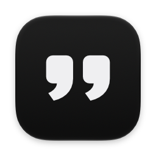
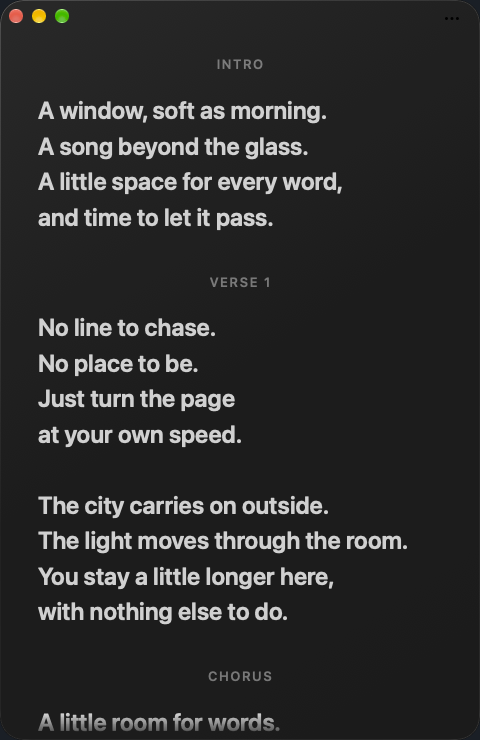
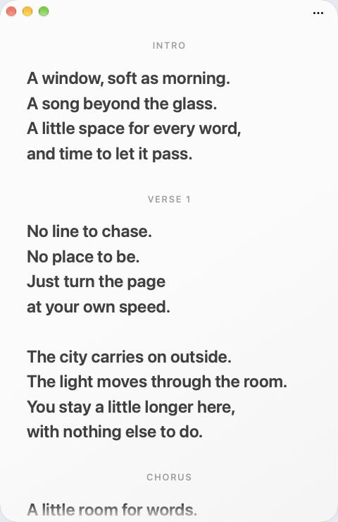
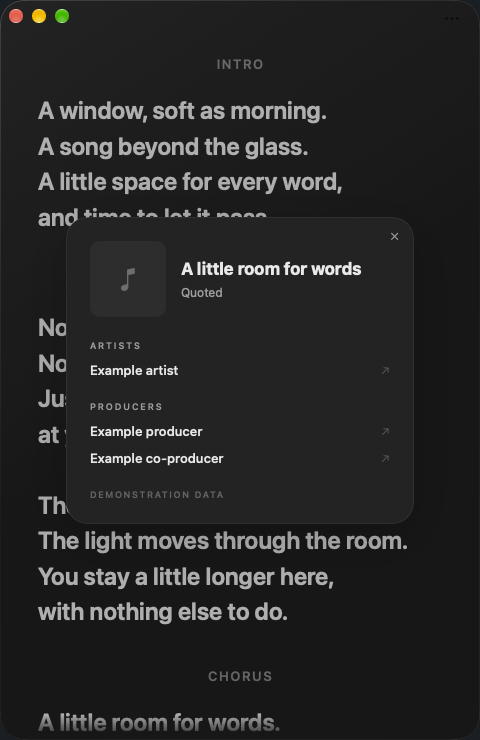

<p align="center">
  
</p>

<h1 align="center">Quoted</h1>
<p align="center"><strong>Your music, in words.</strong></p>
<p align="center">A minimal, native macOS lyrics reader for Spotify.</p>
<p align="center">
  <a href="https://github.com/666serpent/quoted/releases/latest">Download</a> ·
  <a href="#screenshots">Screenshots</a> ·
  <a href="#build-from-source">Build from source</a> ·
  <a href="https://github.com/666serpent/quoted/issues">Report a bug</a>
</p>

Quoted reads the song playing in the Spotify desktop app and finds its lyrics. It gives you a quiet Liquid Glass window with readable text and scrolling at your own pace.

## What it does

- **Just the words.** SF Semibold lyrics, softer section labels, and no persistent song heading or scrollbar.
- **Read at your own pace.** No karaoke highlighting or automatic scrolling. Each new song starts at the top.
- **A movable glass window.** Drag anywhere on the reading surface; text selection is disabled.
- **Song credits, one click away.** The **…** button opens a centered panel with artwork, artists, and producers. Names link to their Genius profiles.
- **Careful matching.** Genius first, LRCLIB as a fallback, and manual corrections you can save for a track.
- **Normal app behavior.** A Dock icon that supports macOS icon appearances, no menu bar or tray item, and quit when you close the window.

## Screenshots

<table>
  <tr>
    <td align="center"><br /><sub>Dark glass</sub></td>
    <td align="center"><br /><sub>Light glass</sub></td>
  </tr>
</table>

<p align="center">
  <br />
  <sub>Artist and producer credits, opened from the … button.</sub>
</p>

Screenshots show the real app using original demonstration text and clearly marked example credits. They contain no listening history or third-party song lyrics.

## Download and install

**Requires macOS 26 or later and the Spotify desktop app.** The prebuilt download is for **Apple silicon (M1 and later)**.

1. [Download Quoted for Apple silicon](https://github.com/666serpent/quoted/releases/latest/download/Quoted-macOS-arm64.zip).
2. Unzip it and move **Quoted.app** to **Applications**.
3. Open Quoted, click **Connect Spotify**, and allow its macOS Automation request.
4. Play a song in Spotify. The lyrics appear automatically.

The current release is locally signed and **not Apple-notarized**. macOS may ask you to approve the first launch in **System Settings → Privacy & Security → Open Anyway**. See [Apple's guidance for opening apps from outside the App Store](https://support.apple.com/en-us/102445). There is no need to disable Gatekeeper.

Each release includes `SHA256SUMS`. If you want to verify the downloaded ZIP, place both files in one folder and run:

```sh
shasum -a 256 -c SHA256SUMS
```

## Using Quoted

Scroll with your mouse or trackpad. Drag the lyrics area to move the window. Pausing keeps the current lyrics visible; closing the window quits the app. Minimizing keeps it in the Dock.

Use the **View** menu for dark glass, light glass, or the system appearance. The app icon uses macOS's native icon catalog, so the Dock can apply its normal, dark, clear, and tinted appearances.

| Action | Shortcut |
| --- | --- |
| Larger / smaller lyrics | ⌘+ / ⌘− |
| Reset text size | ⌘0 |
| Reload lyrics | ⌘R |
| Song credits | ⇧⌘I |
| Choose another lyric match | ⇧⌘L |
| Use a Genius song link | ⇧⌘G |

The same lyric and text-size actions are available from the app menu or by right-clicking the reader. Use **Open Lyric Source** to visit the source page.

Loading shows a spinner. If lyrics are unavailable, the reader shows a small document icon; click it to retry or choose an available match.

## Matching and lyric sources

Quoted tries **Genius**, then **[LRCLIB](https://lrclib.net/docs)** when a suitable Genius text is unavailable. No Spotify login, API token, or Genius account is required.

Automatic matching checks the song title and artist, distinguishes named editions such as live, remix, acoustic, and instrumental versions, and checks duration within three seconds when the source supplies it. Remaster dates and featured-artist suffixes do not change the base song title. Translation and romanization pages are excluded from Genius search results. Conflicting or ambiguous matches require a choice instead of a silent guess.

If a result is wrong, choose **Lyrics → Choose Lyrics…** or paste a correct Genius song link with **Use a Genius Link…**. Quoted remembers the choice for that Spotify track.

**Matching is conservative, not infallible.** Missing pages, incorrect provider metadata, unlabelled clean/explicit editions, access restrictions, and changes to Genius's public pages can prevent a match. Quoted does not generate missing lyrics or bypass service access restrictions. Credits come from the matched Genius record; if no producers are listed, the panel says so.

## Privacy

- Reads the current track ID, title, artist, album, artwork URL, duration, and playing/paused state from Spotify through macOS Apple Events.
- Does not control playback, request your Spotify password, or require Spotify OAuth.
- Sends song metadata to Genius and LRCLIB to find lyrics and credits; artwork is loaded from the URL supplied by the song source.
- Keeps appearance preferences and saved match IDs or links on your Mac.
- Caches up to 40 lyric documents and 40 credit records in memory. They disappear when the app quits.
- Has no analytics or account system.

## Troubleshooting

**Spotify permission was denied**  
Enable **System Settings → Privacy & Security → Automation → Quoted → Spotify**, then retry from the app. Moving the app to Applications before connecting is recommended.

**Nothing is playing / the music-note icon is visible**  
Open the Spotify **desktop app** and play a song. The web player is not supported. Podcasts and ads are ignored. Playback on another device works only if Spotify's desktop app supplies its current track metadata.

**The document icon is visible**  
Try reloading or choosing another match. A source may be unavailable, rate-limited, or missing the song. Quoted honors access denials and rate-limit cooldowns, so repeatedly reloading may not help immediately.

**The Dock shows an older icon or name after an update**  
Quit Quoted, replace the app, and reopen it. If a pinned item points to an old copy, remove that item and keep the newly opened copy in the Dock.

## Build from source

Requires **Swift 6.2+** and a **macOS 26+ SDK**, supplied by Xcode or Command Line Tools. There are no third-party Swift package dependencies.

```sh
git clone https://github.com/666serpent/quoted.git
cd quoted
./scripts/build.sh
open dist/Quoted.app
```

The build targets the Mac's architecture and signs the app locally. Override `QUOTED_BUILD_DIR` or `QUOTED_OUTPUT_DIR` to change build and output locations.

Run the offline tests:

```sh
./scripts/test.sh
```

The suite covers matching, lyric parsing, source failures, fallback behavior, rate limits, and credit records. It does not need Spotify or network access. The optional live provider check is:

```sh
QUOTED_LIVE_TEST=1 ./scripts/test.sh --filter LiveServiceTests
```

Package a release build:

```sh
./scripts/package.sh
```

The ZIP and checksum file appear in `dist/`. Developer ID signing and Apple notarization require the maintainer's own certificates and are not included in this default build.

### Project layout

```text
Sources/Quoted/          Native window, reader UI, Spotify bridge, app state
Sources/QuotedCore/      Provider clients, matching, lyric and credit parsing
Tests/QuotedCoreTests/   Offline tests and optional live provider check
Resources/              Native icon catalog, app metadata, entitlements
scripts/                Build, test, packaging, and screenshot preparation
docs/images/            README screenshots and app icon
```

The original vector icon is in `Resources/AppIcon.icon`. A compiled `Assets.car` is checked in, so normal builds need no icon compiler. See [CONTRIBUTING.md](CONTRIBUTING.md) for screenshot preparation and icon rebuilding.

## Contributing

Bug reports and focused improvements are welcome. See [CONTRIBUTING.md](CONTRIBUTING.md) and [CHANGELOG.md](CHANGELOG.md).

## License and credits

Quoted's source and original assets are available under the [MIT license](LICENSE).

Lyrics, artwork, and song credits belong to their respective owners and providers and are not included in that software license. Quoted is independent and is not affiliated with Spotify, Genius, or LRCLIB. The native icon catalog was generated with [viraptor/actool](https://github.com/viraptor/actool) 2.2.4 and checked with macOS IconServices.
